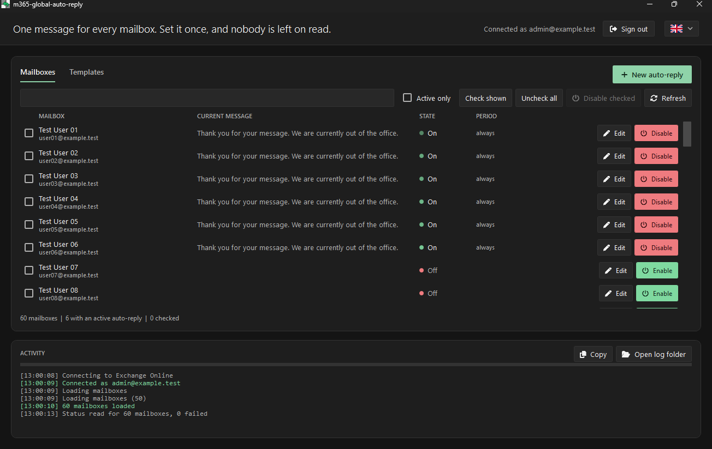
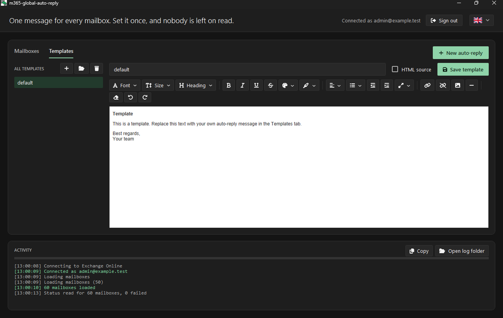
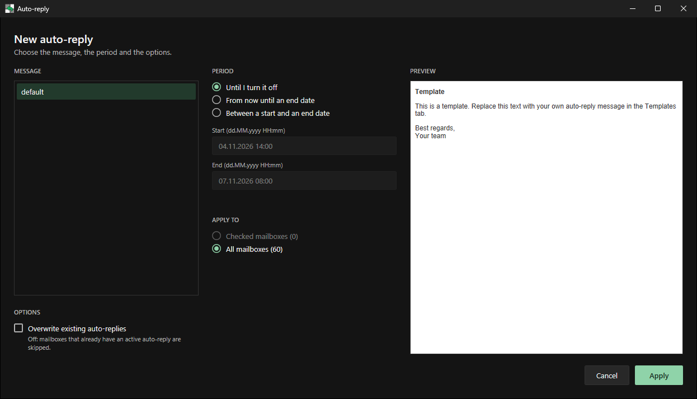

<div align="center">


# m365-global-auto-reply

**One out-of-office message for every mailbox in your Microsoft 365 tenant.**




</div>

> [!IMPORTANT]
> **Alpha, v0.1.0.** Tested thoroughly in a test environment, but a lab never quite matches day-to-day use in a real tenant.
> Try it on a few test mailboxes first and check the result in Outlook. Found a bug? Open an issue and attach the lines from the Activity log.

## What it does

- **See everything:** every mailbox with its auto-reply state, period and current message
- **Set many at once:** one template and one period for the checked mailboxes or all of them
- **Safe by default:** active replies are skipped unless you choose to overwrite, 10 or more mailboxes need a typed confirmation, and one failing mailbox never stops the run
- **Built-in editor:** formatting, links, images and raw HTML, plus import of `.html` and `.md` files
- **English and German** interface

<table>
  <tr>
    <td></td>
    <td></td>
  </tr>
  <tr>
    <td align="center"><sub>Template editor</sub></td>
    <td align="center"><sub>New auto-reply</sub></td>
  </tr>
</table>

## Get started

1. Download the zip from [Releases](../../releases) and start `m365-global-auto-reply.exe`
2. Click **Sign in with Microsoft**. Sign-in runs in your browser, MFA works
3. If the Exchange Online module is missing, the app offers to install it (current user, no admin rights)

**You need** Windows 10 or 11 and a **Microsoft 365 tenant with Exchange Online**, signed in with an account that may manage other mailboxes, for example an Exchange administrator. On-premises Exchange and other mail providers are not supported.

> [!NOTE]
> The exe is not code-signed, so SmartScreen may warn you. You can also run the script directly:
> `powershell -STA -ExecutionPolicy Bypass -File .\src\m365-global-auto-reply.ps1`

## Privacy

The app is plain PowerShell and talks to nothing but **Microsoft Exchange Online**, through Microsoft's official `ExchangeOnlineManagement` module.
There is no server in between, no telemetry, and no password or token is stored. Your data stays between you and Microsoft.

Local logs in `%LOCALAPPDATA%\m365-global-auto-reply\logs` contain mailbox addresses, so remove them before sharing a log.

## Good to know

- **Images** must be hosted online, because Exchange does not accept attachments in auto-replies. Upload the image to [imgbb.com](https://imgbb.com) and paste the direct link, for example `https://i.ibb.co/.../logo.png`
- **Templates** are saved as HTML in `%LOCALAPPDATA%\m365-global-auto-reply\templates`
- **Large tenants:** reading the status takes about one second per mailbox, and the list is usable while it loads

<details>
<summary><b>Build it yourself</b></summary>

<br>

```powershell
.\build.ps1              # check the script, then build dist\m365-global-auto-reply.exe
.\build.ps1 -CheckOnly   # only run the check
```

Try it without a tenant: a mock mode simulates 60 mailboxes.

```powershell
$env:M365AR_MOCK = '1'; powershell -STA -File .\src\m365-global-auto-reply.ps1
```

</details>

## Credits

Built with the help of **Claude** by Anthropic. The idea, the requirements and all testing came from me, Claude wrote most of the code. As with any admin tool, read through it before you point it at your tenant.

Icons by [Font Awesome Free](https://fontawesome.com/license/free) (SIL OFL 1.1 / CC BY 4.0), packaged with [PS2EXE](https://github.com/MScholtes/PS2EXE).
Not affiliated with Microsoft. Microsoft 365, Exchange Online and Outlook are trademarks of Microsoft Corporation. Provided as is, without warranty.

Released under the [MIT License](LICENSE).
